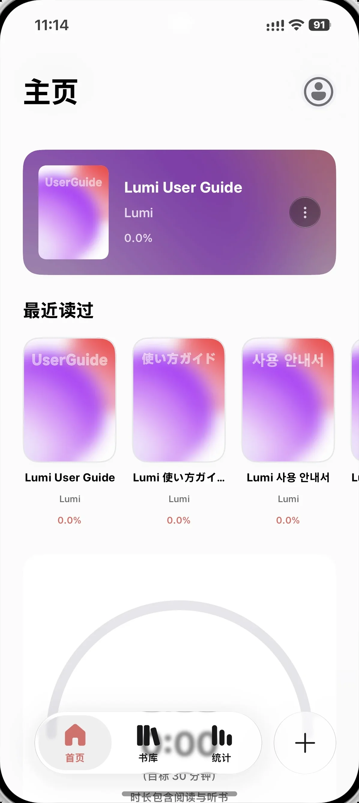
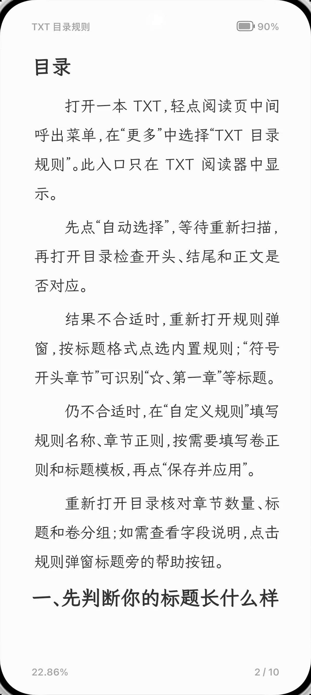
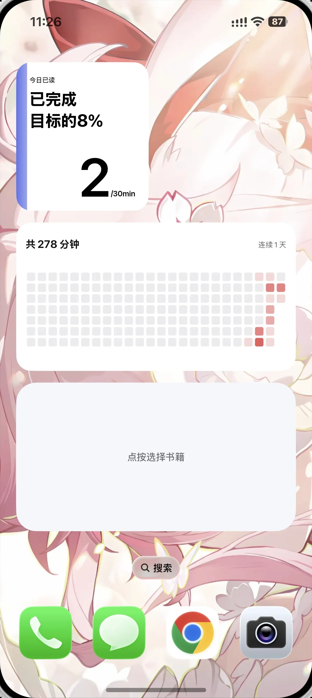

<!-- Language: en | Audience: user -->

# Lumi

**Keep your reading to yourself.**

[中文](README.md) · **English** · [日本語](README.ja.md) · [한국어](README.ko.md)

**User Guide** · [Developer Guide](README.dev.en.md)

Lumi is a local e-book reader for Android. Books and reading data are stored on your phone by default. The basic features are free, open source and ad-free.

  
  
  

## Features

### Reading

- Supports EPUB, PDF, TXT, MOBI, AZW / AZW3 (no DRM), CBZ comics, DOCX / DOC and Markdown.
- EPUB can switch between "publisher layout" (keeps the publisher's styles and fonts) and "reader layout" (unified fonts and typesetting).
- Page turning options: swipe left and right, vertical scroll, fade and realistic page curl.
- Adjustable font size, font, line spacing, letter spacing and margins. Supports vertical text, Simplified/Traditional conversion, Bionic Reading and custom reading backgrounds.
- Two-page reading on tablets and in landscape.
- TXT supports chapter rules: headings are detected by format, or you can define chapters yourself. Replacement rules let you set replace or delete rules for TXT, EPUB and MOBI without modifying the original file.

### Annotations and excerpts

- Highlights, underlines, notes and bookmarks. Highlight colors can be customized with a full color picker.
- "All Highlights and Notes" collects annotations from all books. It supports search and filtering by tag and color.
- Excerpt cards turn selected text, notes or bookmarks into images that you can save or share.
- Notes can be downloaded and exported, which helps you organize your reading records.
- Supports dictionary lookup and translation on selected text. Translation can use an OpenAI-compatible API.

### Bookshelf and remote libraries

- Import books through the system file picker or an authorized library folder, without copying them.
- Covers are extracted automatically. You can also set a custom cover, edit the title and author, or fill in metadata in batch.
- The bookshelf supports Cover Flow, spine layout, drag-to-sort and archiving.
- Connect to an OPDS catalog or a WebDAV server to browse, search and download books.

### Listening mode

- Use the system voice, or connect to the speech synthesis of an OpenAI-compatible API or Xiaomi MiMo.
- The full-screen listening page has a cover mode and a subtitle mode. You can switch chapters and speech engines.
- Listening continues after you leave the book. Floating subtitles show the text being read.
- Supports headset controls and lock screen media controls.

### Statistics and widgets

- Reading time, daily goals, and weekly, monthly and yearly trends and heatmaps.
- Reading streak, annotation count, personal reviews and ratings.
- Home screen widgets can show the book you are reading, and can also display excerpts.

### Sync and backup

- WebDAV syncs books, reading progress, annotations and notes, manually or automatically. You can view the sync status and logs.
- Local backups are exported and imported as ZIP files, containing the database, settings, covers and books.
- Sensitive data such as the WebDAV password and the API Keys for TTS and translation are encrypted with Android KeyStore.

### PDF parsing

- Local parsing: extracts the text layer of a PDF and generates a reflowable e-book. Scanned files are not supported.
- MinerU cloud parsing (third-party service):
  - Lightweight parsing: no Token needed, currently free, up to 10 MB and 20 pages per file.
  - Precise parsing: requires a personal Token, up to 200 MB and 200 pages per file.
  - Manual import: process the file on the MinerU website, then import the resulting ZIP or Markdown.

### Appearance

- Three app styles: Default (custom theme color), Material 3 (dynamic color) and Liquid Glass (adjustable glass transparency).
- Dark mode can follow the system or be set separately.
- The interface supports 7 languages: Simplified Chinese, Traditional Chinese (Taiwan (China), Hong Kong (China), Macau (China)), English, 日本語 and 한국어.

## Privacy

- Reading data is stored on the device by default. App data is in the Android app-private directory.
- The dependencies contain no analytics, advertising, push or crash reporting SDKs.
- Lumi connects to the network only when you use the related features: cover search, remote fonts, WebDAV, MinerU, external speech and translation APIs, update checks and contributor avatars.
- The privacy policy and terms of use are shown on first launch.

## Download

Download the latest APK from [GitHub Releases](https://github.com/huangder/Lumi_Books/releases).

Alternative downloads: [Baidu Netdisk](https://pan.baidu.com/s/1vDdFsoqQuuZlntUTUjssZw?pwd=lumi) (password: lumi) · [Lanzou Cloud (蓝奏云)](https://wwaug.lanzoub.com/b0xxfmxvi) (password: lumi)

## Editions

Lumi comes in an open-source edition and an official edition:

- **Open-source edition** (built from this repository): all reading features and basic excerpt styles. It has no membership entry, reading report or tag management.
- **Official edition**: adds optional Premium features on top of the open-source edition, including the reading report, advanced excerpt templates and tag management. The reading report and advanced excerpts can be previewed, and exporting requires unlocking. The official edition offers a 5-day trial.

For release notes, see the [changelog page](https://huangder.top/changelog.html). They are also available in the app.

## Support Lumi

If Lumi is useful to you, you can support the developer through the [sponsorship page](https://huangder.top/sponsor.html), or with the **Sponsor** button on the right side of the GitHub page. Sponsorship is entirely voluntary and does not affect any feature or issue handling.

## Star History

  

## License

Lumi's original code is open-sourced under the [Apache License 2.0](LICENSE). Third-party dependencies and adapted code follow their own licenses. The page curl renderer and the built-in TXT heading presets are independent implementations. The Liquid Glass effect is adapted from [AndroidLiquidGlass / Backdrop](https://github.com/Kyant0/AndroidLiquidGlass), licensed under Apache 2.0.

© 2026 Huangder

## Links

- Website: [huangder.top](https://huangder.top)
- GitHub: [github.com/huangder/Lumi_Books](https://github.com/huangder/Lumi_Books)
- Email: huangder0104@126.com
