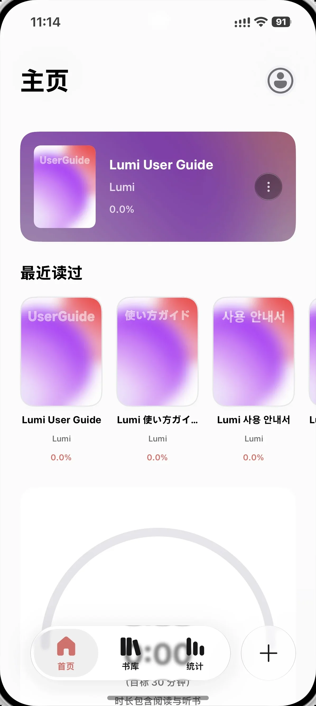
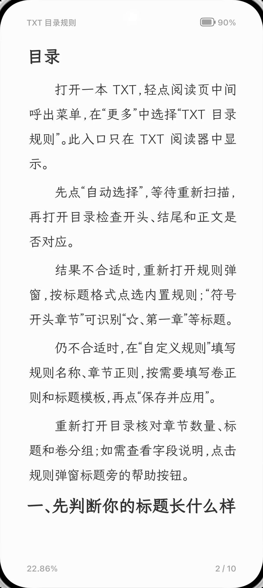
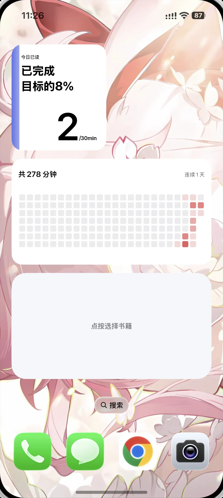

<!-- Language: ja | Audience: user -->

# Lumi

**読書は、自分だけのものに。**

[中文](README.md) · [English](README.en.md) · **日本語** · [한국어](README.ko.md)

**ユーザー版** · [開発者版](README.dev.ja.md)

Lumi は Android 向けのローカル電子書籍リーダーです。書籍と読書データは既定で端末内に保存されます。基本機能は無料・オープンソース・広告なしで提供されます。

  
  
  

## 機能

### 読書

- EPUB、PDF、TXT、MOBI、AZW / AZW3（DRM なし）、CBZ コミック、DOCX / DOC、Markdown に対応しています。
- EPUB は「出版社レイアウト」（出版社のスタイルとフォントを保持）と「リーダーレイアウト」（フォントと組版を統一）を切り替えられます。
- ページめくりは、左右スワイプ、上下スクロール、フェード切り替え、ページカールから選べます。
- 文字サイズ、フォント、行間、字間、余白を調整できます。縦書き、簡体字・繁体字の変換、バイオニック・リーディング、読書背景のカスタマイズに対応しています。
- タブレットや横向きの画面では、見開きで読めます。
- TXT は目次ルールに対応しています。見出しの形式に従って章を自動で認識するほか、手動で設定することもできます。置換クリーンアップでは、TXT、EPUB、MOBI に対して置換・削除のルールを設定できます。元のファイルは変更されません。

### 注釈と抜粋

- ハイライト、下線、メモ、しおりを付けられます。ハイライトの色は、フルカラーピッカーで変更できます。
- 「すべてのハイライトとメモ」で、全書籍の注釈をまとめて確認できます。検索や、タグと色による絞り込みに対応しています。
- 抜粋カードは、選択した文字、メモ、しおりを画像にして保存・共有できます。
- メモは書き出しができるため、読書記録の整理に使えます。
- 単語の辞書引きと翻訳に対応しています。翻訳は OpenAI 互換の API に接続できます。

### 書棚とリモートライブラリ

- システムのファイル選択画面、または許可したライブラリフォルダから書籍を取り込めます。コピーは不要です。
- 表紙は自動で取得されます。表紙の変更、書名や著者の編集、一括補完もできます。
- 書棚は Cover Flow と背表紙形式のレイアウトに対応しています。ドラッグで並べ替えたり、アーカイブしたりできます。
- OPDS カタログや WebDAV サーバーに接続して、書籍を閲覧・検索・ダウンロードできます。

### 読み上げ

- システムの音声のほか、OpenAI 互換の API や Xiaomi MiMo の音声合成に接続できます。
- 全画面の読み上げ画面は、表紙モードと字幕モードから選べます。章と音声エンジンを切り替えられます。
- 書籍を閉じた後も読み上げを続けられます。フローティング字幕で読み上げ中の内容を確認できます。
- イヤホンのリモコン操作と、ロック画面のメディアコントロールに対応しています。

### 統計とウィジェット

- 読書時間、1日の目標、週・月・年の推移とヒートマップを表示します。
- 連続読書日数、注釈の数、個人の書評と評価を記録できます。
- ホーム画面のウィジェットで、続きから読む書籍や抜粋を表示できます。

### 同期とバックアップ

- WebDAV で書籍、読書の進捗、注釈、メモを同期できます。手動でも自動でも同期でき、同期の状態とログを確認できます。
- ローカルバックアップは ZIP 形式で書き出し・読み込みできます。データベース、設定、表紙、書籍が含まれます。
- WebDAV のパスワードや、TTS・翻訳の API キーなどの機密情報は、Android KeyStore で暗号化して保存されます。

### PDF 解析

- ローカル解析：PDF のテキストレイヤーを抽出し、リフロー可能な電子書籍を作成します。スキャンされた画像には対応していません。
- MinerU クラウド解析（サードパーティのサービス）：
  - 軽量解析：Token 不要で、現在は無料です。1 ファイルあたり最大 10 MB、20 ページ。
  - 精密解析：個人の Token が必要です。1 ファイルあたり最大 200 MB、200 ページ。
  - 手動取り込み：MinerU の Web サイトで処理した後、得られた ZIP または Markdown を取り込みます。

### 外観

- アプリのスタイルは 3 種類から選べます。デフォルト（テーマカラーを変更可能）、Material 3（ダイナミックカラー）、Liquid Glass（ガラス効果の透過度を調整可能）です。
- ダークモードは、システムの設定に従うことも、個別に設定することもできます。
- 表示言語は 7 種類です。簡体字中国語、繁体字中国語（台湾（中国）・香港（中国）・マカオ（中国））、English、日本語、한국어に対応しています。

## プライバシー

- 読書データは既定で端末内に保存されます。アプリのデータは Android のアプリ専用領域に置かれます。
- 依存関係に、アナリティクス、広告、プッシュ通知、クラッシュレポートの SDK は含まれていません。
- ネットワーク通信が発生するのは、利用者が該当する機能を使ったときだけです。表紙の検索、リモートフォント、WebDAV、MinerU、外部の音声・翻訳 API、更新の確認、コントリビューターのアバター表示が対象です。
- 初回起動時に、プライバシーポリシーと利用規約を表示します。

## ダウンロード

[GitHub Releases](https://github.com/huangder/Lumi_Books/releases) から最新の APK をダウンロードできます。

予備のダウンロード先：[百度网盘](https://pan.baidu.com/s/1vDdFsoqQuuZlntUTUjssZw?pwd=lumi)（パスワード：lumi） · [蓝奏云](https://wwaug.lanzoub.com/b0xxfmxvi)（パスワード：lumi）

## バージョンについて

Lumi には 2 つのバージョンがあります。

- **オープンソース版**（このリポジトリからビルドされるもの）：読書機能と基本の抜粋スタイルをすべて提供します。会員向けの入口、読書レポート、タグ管理は含まれません。
- **公式版**：オープンソース版に、任意で利用できる Premium 機能を加えたものです。読書レポート、高度な抜粋テンプレート、タグ管理を含みます。読書レポートと高度な抜粋はプレビューできます。書き出しにはロック解除が必要です。公式版には 5 日間の試用期間があります。

更新履歴は [更新ログのページ](https://huangder.top/changelog.html) で確認できます。アプリ内でも見られます。

## Lumi を支援する

Lumi が役に立ったと感じたら、[支援ページ](https://huangder.top/sponsor.html) から開発者を支援できます。GitHub ページ右側の **Sponsor** ボタンからも支援できます。支援は任意で、機能の利用やサポートには影響しません。

## Star History

  

## ライセンス

Lumi のオリジナルコードは [Apache License 2.0](LICENSE) で公開されています。サードパーティの依存関係および改変されたコードは、それぞれのライセンスに従います。カール型のページめくりと TXT 目次プリセットは独立して実装されています。Liquid Glass の効果は、Apache 2.0 ライセンスの [AndroidLiquidGlass / Backdrop](https://github.com/Kyant0/AndroidLiquidGlass) を改変したものです。

© 2026 Huangder

## リンク

- 公式サイト：[huangder.top](https://huangder.top)
- GitHub：[github.com/huangder/Lumi_Books](https://github.com/huangder/Lumi_Books)
- メール：huangder0104@126.com
