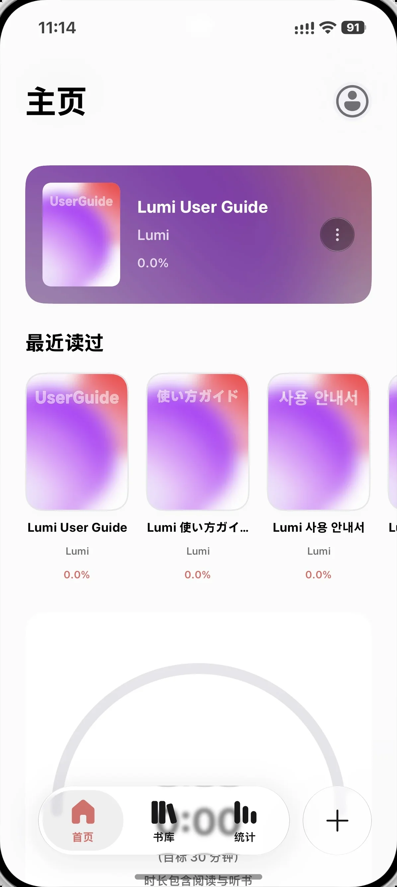
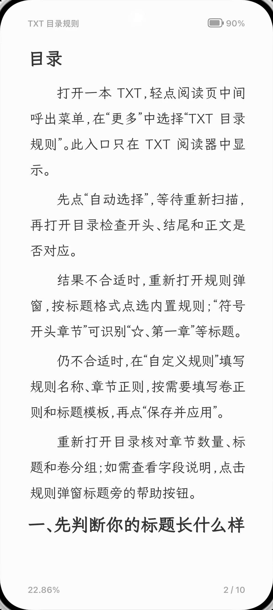
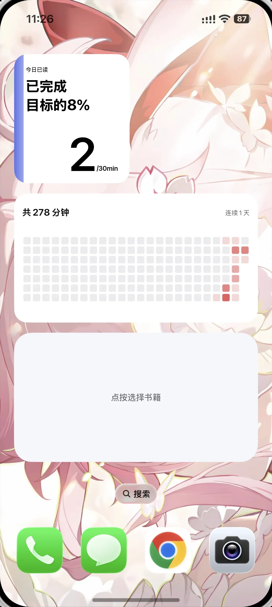

<!-- Language: ko | Audience: user -->

# Lumi

**읽는 시간은 나에게만.**

[中文](README.md) · [English](README.en.md) · [日本語](README.ja.md) · **한국어**

**사용자 버전** · [개발자 버전](README.dev.ko.md)

Lumi는 Android용 로컬 전자책 리더입니다. 책과 독서 데이터는 기본적으로 기기 안에 저장됩니다. 기본 기능은 무료이며 오픈소스이고, 광고가 없습니다.

  
  
  

## 기능

### 읽기

- EPUB, PDF, TXT, MOBI, AZW / AZW3(DRM 없음), CBZ 만화, DOCX / DOC, Markdown을 지원합니다.
- EPUB은 "출판사 레이아웃"(출판사의 스타일과 글꼴 유지)과 "리더 레이아웃"(글꼴과 조판 통일) 사이에서 전환할 수 있습니다.
- 페이지 넘김은 좌우 스와이프, 상하 스크롤, 페이드 전환, 페이지 컬 중에서 고를 수 있습니다.
- 글자 크기, 글꼴, 줄 간격, 자간, 여백을 조절할 수 있습니다. 세로쓰기, 간체·번체 변환, Bionic Reading, 읽기 배경 사용자 지정을 지원합니다.
- 태블릿이나 가로 화면에서는 두 쪽 보기로 읽을 수 있습니다.
- TXT는 목차 규칙을 지원합니다. 제목 형식에 따라 장을 자동으로 인식하거나 직접 설정할 수 있습니다. 텍스트 정리 규칙으로 TXT, EPUB, MOBI에 치환 또는 삭제 규칙을 설정할 수 있으며, 원본 파일은 바뀌지 않습니다.

### 메모와 발췌

- 하이라이트, 밑줄, 메모, 책갈피를 추가할 수 있습니다. 하이라이트 색은 전체 색상 선택기로 바꿀 수 있습니다.
- "모든 하이라이트와 메모"에서 모든 책의 표시를 한곳에 모아 볼 수 있습니다. 검색하거나 태그와 색으로 거를 수 있습니다.
- 발췌 카드는 선택한 글, 메모, 책갈피를 이미지로 만들어 저장하거나 공유합니다.
- 메모를 내보낼 수 있어서 독서 기록을 정리하기 좋습니다.
- 단어 사전 찾기와 번역을 지원합니다. 번역은 OpenAI 호환 API에 연결할 수 있습니다.

### 서재와 원격 서재

- 시스템 파일 선택기나 허가한 서재 폴더에서 책을 가져올 수 있습니다. 복사할 필요가 없습니다.
- 표지는 자동으로 추출됩니다. 표지를 바꾸거나 제목과 저자를 수정하거나 일괄로 채울 수도 있습니다.
- 서재는 Cover Flow와 책등 형식 배치를 지원합니다. 끌어서 순서를 바꾸거나 보관할 수 있습니다.
- OPDS 카탈로그나 WebDAV 서버에 연결해 책을 찾아보고, 검색하고, 내려받을 수 있습니다.

### 듣기

- 시스템 음성을 쓸 수 있고, OpenAI 호환 API나 Xiaomi MiMo 음성 합성에도 연결할 수 있습니다.
- 전체 화면 듣기 화면은 표지 모드와 자막 모드 중에서 고를 수 있습니다. 장과 음성 엔진을 바꿀 수 있습니다.
- 책을 닫은 뒤에도 계속 들을 수 있습니다. 떠 있는 자막으로 읽고 있는 내용을 확인할 수 있습니다.
- 이어폰 리모컨 조작과 잠금 화면 미디어 컨트롤을 지원합니다.

### 통계와 위젯

- 독서 시간, 하루 목표, 주·월·년 추이와 히트맵을 보여 줍니다.
- 연속 독서 일수, 주석 수, 개인 서평과 평점을 기록할 수 있습니다.
- 홈 화면 위젯에서 이어 읽을 책이나 발췌를 볼 수 있습니다.

### 동기화와 백업

- WebDAV로 책, 읽기 진행 상황, 메모를 동기화할 수 있습니다. 수동으로도, 자동으로도 동기화할 수 있으며 동기화 상태와 로그를 확인할 수 있습니다.
- 로컬 백업은 ZIP 형식으로 내보내고 가져올 수 있습니다. 데이터베이스, 설정, 표지, 책이 포함됩니다.
- WebDAV 비밀번호와 TTS·번역 API 키 같은 민감한 정보는 Android KeyStore로 암호화해 저장합니다.

### PDF 분석

- 로컬 분석: PDF의 텍스트 레이어를 추출해 리플로우가 가능한 전자책을 만듭니다. 스캔 이미지는 지원하지 않습니다.
- MinerU 클라우드 분석(제3자 서비스):
  - 경량 분석: Token이 필요 없고 현재 무료입니다. 파일당 최대 10 MB, 20쪽.
  - 정밀 분석: 개인 Token이 필요합니다. 파일당 최대 200 MB, 200쪽.
  - 수동 가져오기: MinerU 웹사이트에서 처리한 뒤 얻은 ZIP 또는 Markdown을 가져옵니다.

### 외관

- 앱 스타일은 세 가지 중에서 고를 수 있습니다. 기본(테마 색 변경 가능), Material 3(동적 색상), Liquid Glass(유리 효과의 투명도 조절 가능)입니다.
- 다크 모드는 시스템 설정을 따르거나 따로 설정할 수 있습니다.
- 표시 언어는 일곱 가지입니다. 중국어 간체, 중국어 번체(대만(중국)·홍콩(중국)·마카오(중국)), English, 日本語, 한국어를 지원합니다.

## 개인정보

- 독서 데이터는 기본적으로 기기 안에 저장됩니다. 앱 데이터는 Android의 앱 전용 저장 공간에 있습니다.
- 의존성에는 분석, 광고, 푸시 알림, 충돌 보고 SDK가 포함되어 있지 않습니다.
- 네트워크 연결은 사용자가 해당 기능을 사용할 때만 일어납니다. 표지 검색, 원격 글꼴, WebDAV, MinerU, 외부 음성·번역 API, 업데이트 확인, 기여자 아바타 표시가 여기에 해당합니다.
- 처음 실행할 때 개인정보 처리방침과 이용약관을 보여 줍니다.

## 다운로드

[GitHub Releases](https://github.com/huangder/Lumi_Books/releases)에서 최신 APK를 내려받을 수 있습니다.

예비 다운로드: [百度网盘](https://pan.baidu.com/s/1vDdFsoqQuuZlntUTUjssZw?pwd=lumi)(비밀번호 lumi) · [蓝奏云](https://wwaug.lanzoub.com/b0xxfmxvi)(비밀번호 lumi)

## 버전 안내

Lumi에는 두 가지 버전이 있습니다.

- **오픈소스 버전**(이 저장소에서 빌드되는 버전): 읽기 기능과 기본 발췌 스타일을 모두 제공합니다. 멤버십 진입점, 독서 리포트, 태그 관리는 포함되지 않습니다.
- **공식 버전**: 오픈소스 버전에 선택 사항인 Premium 기능을 더한 버전입니다. 독서 리포트, 고급 발췌 템플릿, 태그 관리를 포함합니다. 독서 리포트와 고급 발췌는 미리 볼 수 있으며, 내보내려면 잠금을 해제해야 합니다. 공식 버전은 5일 체험판을 제공합니다.

업데이트 기록은 [업데이트 로그 페이지](https://huangder.top/changelog.html)에서 볼 수 있습니다. 앱 안에서도 확인할 수 있습니다.

## Lumi 후원

Lumi가 도움이 되었다면 [후원 페이지](https://huangder.top/sponsor.html)에서 개발자를 후원할 수 있습니다. GitHub 페이지 오른쪽의 **Sponsor** 버튼으로도 후원할 수 있습니다. 후원은 자유 의사이며, 기능 이용이나 문제 처리에는 영향을 주지 않습니다.

## Star History

  

## 라이선스

Lumi의 원본 코드는 [Apache License 2.0](LICENSE)으로 공개됩니다. 제3자 의존성과 개작된 코드는 각자의 라이선스를 따릅니다. 말림 방식의 페이지 넘김과 내장 TXT 목차 프리셋은 독자적으로 구현되었습니다. Liquid Glass 효과는 Apache 2.0 라이선스의 [AndroidLiquidGlass / Backdrop](https://github.com/Kyant0/AndroidLiquidGlass)을 개작한 것입니다.

© 2026 Huangder

## 링크

- 공식 사이트: [huangder.top](https://huangder.top)
- GitHub: [github.com/huangder/Lumi_Books](https://github.com/huangder/Lumi_Books)
- 이메일: huangder0104@126.com
