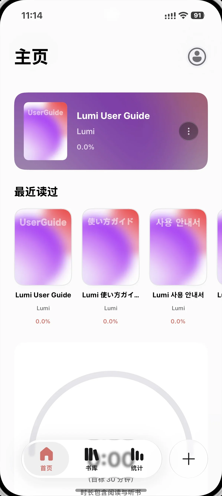
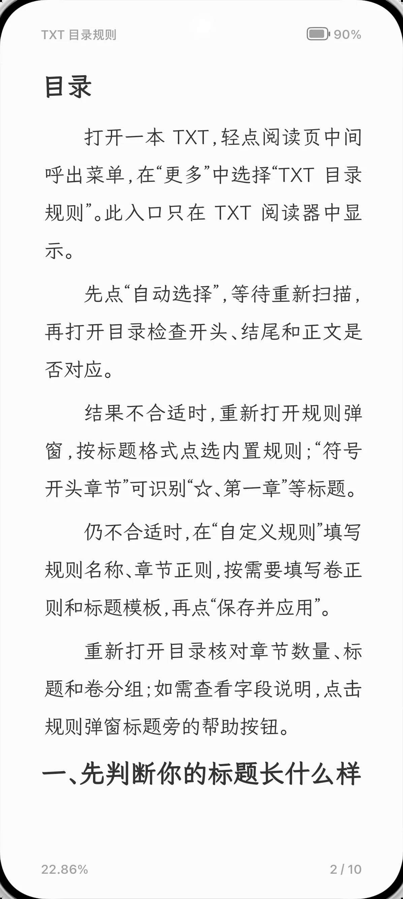
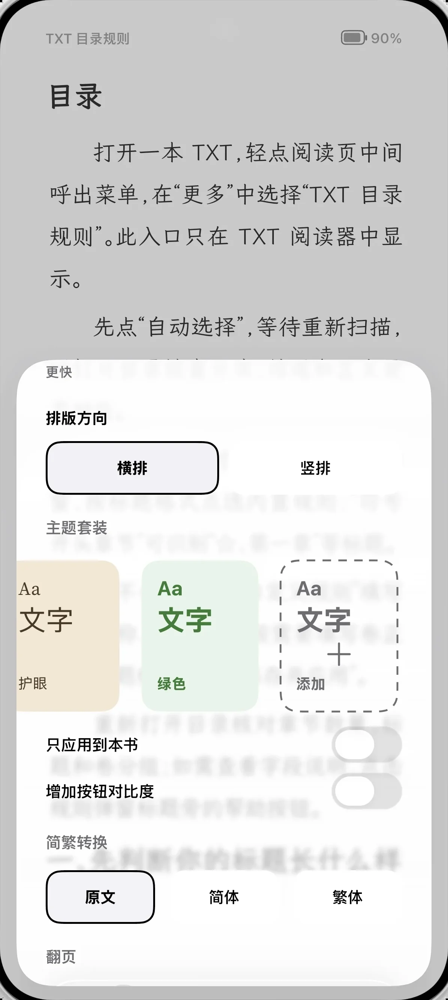
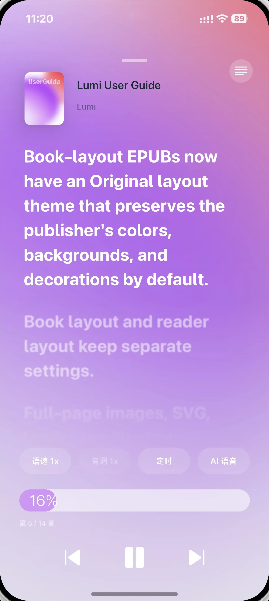
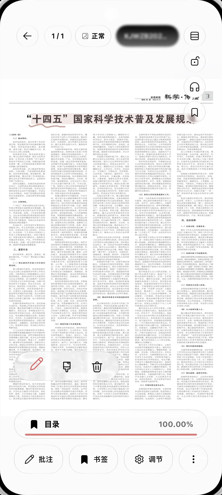
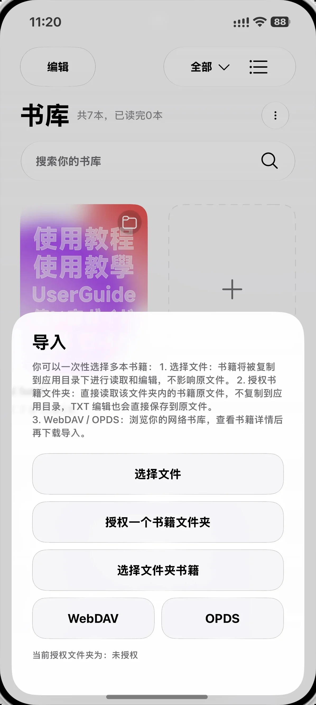

<!-- Language: zh | Audience: user -->

# Lumi

<h3 align="center">一款 Android 本地电子书阅读器</h3>

[下载最新版](https://github.com/huangder/Lumi_Books/releases) | [功能介绍](https://huangder.top/features.html) | [更新日志](https://huangder.top/changelog.html) | [隐私政策](https://huangder.top/privacy.html) | [赞助](https://huangder.top/sponsor.html)

**中文** · [English](README.en.md) · [日本語](README.ja.md) · [한국어](README.ko.md)

**用户版** · [开发者版](README.dev.md)

Lumi 是一款 Android 本地电子书阅读器。书籍和阅读数据默认保存在手机上，基础功能免费、开源、无广告。

## 截图

<table align="center" width="100%">
  <tr>
    <td align="center" width="50%">
      <b>首页</b>
       
       
      
    </td>
    <td align="center" width="50%">
      <b>阅读</b>
       
       
      
    </td>
  </tr>
  <tr>
    <td align="center" width="50%">
      <b>阅读设置</b>
       
       
      
    </td>
    <td align="center" width="50%">
      <b>听书</b>
       
       
      
    </td>
  </tr>
  <tr>
    <td align="center" width="50%">
      <b>批注与书签</b>
       
       
      
    </td>
    <td align="center" width="50%">
      <b>导入与远程书库</b>
       
       
      
    </td>
  </tr>
</table>

## 功能

### 阅读

- 支持 EPUB、PDF、TXT、MOBI、AZW / AZW3（无 DRM）、CBZ 漫画、DOCX / DOC 和 Markdown。
- EPUB 可在「书版排版」（保留出版方的样式与字体）和「阅读器排版」（统一字体与版式）之间切换。
- 翻页方式包括左右滑动、上下滚动、渐变切换和仿真卷曲。
- 可调整字号、字体、行距、字间距和页边距，支持竖排、简繁转换、仿生阅读和自定义阅读背景。
- 平板和横屏下可双页阅读。
- TXT 支持目录规则，可按标题格式自动识别或自定义章节。替换净化可为 TXT、EPUB、MOBI 设置替换或删除规则，不修改原文件。

### 标注与摘录

- 高亮、划线、笔记和书签。高亮颜色可用完整选色器自定义。
- 「全部高亮与笔记」汇总所有书籍的标注，支持搜索，并可按标签和颜色筛选。
- 摘录卡片可把选中的文字、笔记或书签生成图片，保存或分享。
- 笔记可下载和导出，方便整理阅读记录。
- 支持划词词典和翻译，翻译可接入 OpenAI 兼容接口。

### 书架与远程书库

- 通过系统文件选择器或授权书库文件夹导入书籍，无需复制。
- 封面自动提取，也可自定义封面、修改书名和作者，或批量补全。
- 书架支持 Cover Flow、书脊式布局、拖动排序和归档。
- 连接 OPDS 目录或 WebDAV 服务器，浏览、搜索并下载书籍。

### 听书

- 可使用系统语音，也可接入 OpenAI 兼容接口或小米 MiMo 的语音合成。
- 全屏听书页提供封面和字幕两种模式，可切换章节和语音引擎。
- 退出书籍后可继续听书，并通过悬浮字幕查看朗读内容。
- 支持耳机线控和锁屏媒体控件。

### 统计与小组件

- 阅读时长、每日目标，以及周、月、年的趋势和热力图。
- 连续阅读天数、标注数量、个人书评与评分。
- 桌面小组件可显示继续阅读的书籍，也可展示摘录。

### 同步与备份

- WebDAV 同步书籍、阅读进度、标注和笔记，可手动或自动进行，并可查看同步状态和日志。
- 本地备份以 ZIP 导出和导入，包含数据库、设置、封面和书籍。
- WebDAV 密码、TTS 和翻译的 API Key 等敏感信息使用 Android KeyStore 加密保存。

### PDF 解析

- 本地解析：提取 PDF 的文字层并生成可重排的电子书，不支持扫描件。
- MinerU 云端解析（第三方服务）：
  - 轻量解析：免 Token，目前免费，单个文件最大 10 MB、20 页。
  - 精准解析：需要个人 Token，单个文件最大 200 MB、200 页。
  - 手动导入：在 MinerU 网站处理后，导入得到的 ZIP 或 Markdown。

### 外观

- 三种应用风格：默认（可自定义主题色）、Material 3（动态取色）和液态玻璃（可调玻璃通透度）。
- 深色模式可跟随系统，也可单独设置。
- 界面支持 7 种语言：简体中文、繁体中文（台湾、香港、澳门）、English、日本語、한국어。

## 隐私

- 阅读数据默认保存在本机，应用数据位于 Android 应用私有目录。
- 依赖中没有分析、广告、推送或崩溃上报 SDK。
- 只有在你主动使用相关功能时才会联网：封面搜索、远程字体、WebDAV、MinerU、外部语音与翻译接口，以及检查更新和贡献者头像。
- 首次启动时会展示隐私政策和用户协议。

## 下载

从 [GitHub Releases](https://github.com/huangder/Lumi_Books/releases) 下载最新 APK。

备用下载：[百度网盘](https://pan.baidu.com/s/1vDdFsoqQuuZlntUTUjssZw?pwd=lumi)（密码 lumi） · [蓝奏云](https://wwaug.lanzoub.com/b0xxfmxvi)（密码 lumi）

## 版本说明

Lumi 分为开源版和官方版：

- **开源版**（本仓库构建）：提供全部阅读功能和基础摘录样式，不含会员入口、阅读报告和标签管理。
- **官方版**：在开源版之上提供可选的 Premium 功能，包括阅读报告、高级摘录模板和标签管理。阅读报告和高级摘录可以预览，导出需要解锁；官方版提供 5 天试用。

更新记录见 [更新日志页](https://huangder.top/changelog.html)，应用内也可以查看。

## 支持 Lumi

如果 Lumi 对你有帮助，可以通过 [赞助页](https://huangder.top/sponsor.html) 支持开发者，也可以使用 GitHub 页面右侧的 **Sponsor** 按钮。赞助完全自愿，不影响任何功能和问题处理。

## Star History

  

## 许可证

Lumi 原创代码采用 [Apache License 2.0](LICENSE) 开源。第三方依赖及改编代码遵循各自的许可证；卷曲翻页与内置 TXT 目录预设为独立实现；液态玻璃效果改编自 Apache 2.0 许可的 [AndroidLiquidGlass / Backdrop](https://github.com/Kyant0/AndroidLiquidGlass)。

© 2026 Huangder

## 链接

- 官网：[huangder.top](https://huangder.top)
- GitHub：[github.com/huangder/Lumi_Books](https://github.com/huangder/Lumi_Books)
- 邮箱：huangder0104@126.com
