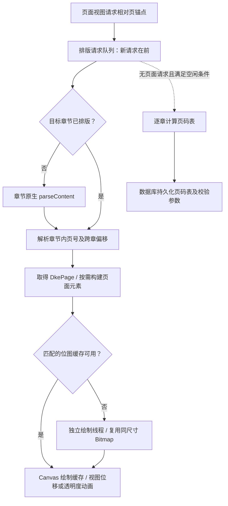

# 多看 EPUB 排版与快速跨章翻页：静态逆向研究

2026-11-08，样本为多看阅读 8.4.19。续接 [APK 格式与交互研究](duokan-apk-reverse-research.md)。

## 主要发现

多看的可见实现把章节分页、页码索引、页面元素、位图绘制、翻页视图分成不同生命周期。当前页面请求优先处理，全书页码计算退到空闲阶段；页面绘制走独立线程和可复用位图；跨章使用连续的页面锚点及可复用页面视图。它有原生排版内核，但这些调度与缓存策略也可以在 Lumi 现有 WebView 架构中独立实现。

Lumi 已有前／中／后 WebView、第四个预热 WebView、方向预测、跨章边缘预热、页面角色交换和快照保护。下一步应测清“新章准备”和“跨章后紧接着翻第二页”的等待链，优先减少整章媒体等待、重复页面准备和非必要后台竞争。

本轮结论来自反编译调用链，**没有运行多看、没有测量其帧率或翻页耗时**。这里解释的是代码支持的流畅度机制，不能证明每本书、每次跨章都不掉帧。Lumi 的瓶颈候选也需要真机时序确认，不能把源码注释中的耗时当成本轮测量。

## 样本与证据

APK：`E:/download/base.apk`，SHA-256 为 `daa8c4044dc8533c120d95b18b0db4fbdce9384b0abe40ee2c248a9706e97b36`。沿用上一轮的 `classes3/11/12.dex`，本轮额外提取并用 JADX 1.5.6 反编译 `classes5.dex`，追到阅读 UI、页面视图复用及内存预算的实际调用方。

新增 DEX 大小 4,815,020 bytes，SHA-256 为 `92b62f7fa500b9c0e4d54e1fbf842a90167df4373db870562f609083e352973e`。新增反编译目录是 `.local/duokan-research/apk/performance-ui/`；其余 Java 证据位于同级 `decompiled/`。这些目录均留在忽略的研究区。

本机 [证据索引](../.local/duokan-research/apk/performance-evidence.json) 记录每条证据的路径、起始行、方法定位标记和源码 SHA-256，编号 `DK01–DK20`、`LU01–LU08` 对应下文。可用本机脚本 `performance_evidence.py` 重新定位。公开报告记录行为和方法名，没有把反编译实现或原生库放入应用源码。

本轮检查的 Lumi 公开/Premium 仓库均为 `codex/integration-current`，HEAD 分别为 `3e48dfea93740fdc19cc9faffe837f0fd121fd97`、`7e2150cda89ee356d42aecd69b3fd166ef0203e2`；两边原有未提交改动均保留。对照分析包含当前工作区实际源码，不能仅按 HEAD 复现，需要同时核对索引中的文件哈希。

## 从手势到页面的调用链

这张图是已读方法之间的职责关系，不表示所有线程可同时无锁执行，也不表示所有翻页动画都使用同一条实现。

## 1. 页面请求先做，整本页码后算

`EpubTypesettingContext.n/m` 将新请求加到链表头部并释放信号量；`s()` 按队列顺序找未处理请求，跳过完成项并标记丢弃项。`bz0` 明确区分 handled、done、discarded。`EpubDocument.B2()` 在有请求时先调用 `z1()`，没有请求时才进入整书页码工作分支。[DK01、DK02]

这里存在具体的空闲门槛：最近一次页面请求后不超过 **2000 ms** 时，调度循环等待信号；只有无请求且上下文等条件满足，才调用 `y2/y1` 恢复或推进页码计算。循环中的 **500 ms** 是可被信号量唤醒的等待，不是每次翻页固定延迟。[DK01]

`y1()` 每次推进一个待计算章节，然后重新回到调度循环。所有章节页码可用后才计算全书总数并通过宿主接口保存页码表。这避免把整本书排完作为第一页出现的前提。[DK05]

**限制：**这证明队列选择和章节之间的让步，没有证明正在执行的原生 `parseContent/calcChapterPages` 可以被中断。最新请求也可能等到当前章节工作返回；不能称作原生任务级抢占。

## 2. 页码表与完整页面对象分开保存

`EpubDocument.A2()` 用章节状态区分未排版／排版中／已排版；同一上下文中已完成的章节直接返回。它调用原生 `parseContent` 后，枚举章节页，保存每页开始处的段落／atom 位置。[DK03]

另一路 `w2()` 调用 `calcChapterPages`，只将结果写入章节页码数组；不会在这个 Java 方法里建立页面 Drawable 或申请全页 Bitmap。`EpubTypesettingContext.o()` 对页起点数组二分查找，用于位置与全书页索引的转换。[DK04]

`EpubTypesettingContext.w()` 在排版参数相容时复制可复用的章节页码数组，并排除章节级补页配置发生变化的项。`B2()` 同时会清理原生已排版页面、重置章节排版状态。这说明**复用页码索引不等于复用所有原生页面对象**。[DK09、DK10、DK01]

两套 native API 的内部测量算法、是否共享完整中间布局、各自内存成本，本轮没有恢复。也没有证据表明它能把超长章节只排几段就返回：已读 Java 主路径的 `parseContent` 粒度是章节。

## 3. 页码表会落盘，且认真校验失效条件

书架类 `com.duokan.reader.domain.bookshelf.l.o` 实现 `nx0`：

- `e()` 将 `long[][]` 页码表序列化到数据库，并保存书 ID、内核版本、排版参数、文件大小、修改时间及文档侧签名。
- `n()` 读取时核对文件信息、内核版本、签名和排版配置，相容才反序列化；不相容走失效处理。
- `EpubDocument.y2()` 恢复索引到尚未排版的章节；完整页面仍按需准备。

排版等价比较包含页面尺寸、两组边距、字号、行距、段距、首行缩进、字体映射及相关布局字段。文档签名有不同生成路径，不能一律解释成整本文件的内容 SHA-256。[DK07、DK08、DK09]

实际意义是重开同一本书、配置未变时，可以更早获得页码和定位信息；它**不能单独消除目标章节的首次排版和绘制成本**。

## 4. 排版之后还有单独的页面元素与绘制阶段

`ny0` 是单页 Drawable。排版结果回调 `l(zy0)` 取得原生 `DkePage`，通过 `checkPageElements()` 判断是否需要 `buildPageElements()`，随后建立图片、脚注等页面交互对象，并请求位图准备。[DK11]

页面位图由 `ze2` 管理，`ze2` 构造时启动独立线程。`ny0.h` 的绘制回调进入 `p2()`，向原生 `DkePage.render` 提供已有 Bitmap。UI 绘制路径查找缓存，由 `ze2.e.u()` 画 Bitmap 或 BitmapShader。[DK12、DK13、DK14]

缓存匹配包含排版上下文对象、页面锚点、绘制配置对象、目标区域及缩放比例；完整区域匹配可直接复用，也有区域覆盖评分及后续替换路径。这比只按“章节号＋页号”缓存更能防止字体、尺寸或绘制配置变化后误用旧图。[DK14]

`FlowPagesView.C3()` 中已读到覆盖／淡入动画直接设置页面 cell 位移和透明度；页面适配器复用页面 View。对已经准备好的页，这条动画路径不需要每帧重新运行章节解析。[DK19]

**范围：**本轮确认的是这些普通流式页面路径，未追完所有仿真卷页、特殊媒体和广告页面的动画实现；不把它们概括成统一 GPU 算法。

## 5. 绘制队列偏向新工作，内存按字节管理

`ze2.n()` 从链表尾部选择最新的未完成条目；已取消任务走取消回调。它会从可回收条目接走**尺寸和 Bitmap.Config 相同**的位图，减少重复申请；申请前按字节预算回收未受保护条目的 Bitmap，完成后保留可被后续命中的结果。[DK13]

`ze2` 的默认预算虽然是 3 MiB，但阅读 UI 会调用 `as0.K0()` 覆盖，不能据此说“多看只用 3 MiB”：已读到的设置公式为 `屏幕宽×高×2×6`，或 `屏幕宽×高×(滚动 ? 4 : 2)×4`。具体选择还受阅读模式分支控制。[DK15]

这是绘制缓存预算，**不是应用总内存，也不是固定缓存 4 页／6 页的证明**。存在仍受保护的条目时，回收循环也不构成绝对内存硬上限。对 Lumi 的直接启示是按像素字节和使用状态控制快照池，而非无限增加 WebView 或预加载章节。

## 6. 跨章沿用连续页锚点和可复用视图

阅读页适配器的 `e.d.move(i)` 委托文档创建相对页锚点；`EpubDocument.S()` 对单页创建带偏移的新 `EpubSinglePageAnchor`。`z1()` 按页偏移及章节页数解析目标，必要时对经过或落入的章节调用 `A2()`；首尾越界也有明确结果状态。[DK06、DK18]

`FlowPagesView` 初始化相对位置 `-1/0/+1`；`W3()` 随可视区域补充页面，能够重新分配另一端的离屏条目及其 View。初始容量为 3 不代表滚动时永远只有 3 项。[DK16、DK17]

因此跨章在这条路径里是“连续页序列中的下一个页面”，沿用排版上下文、位图缓存和页面 View。它无需在章边界引入一次 WebView 新文档加载；这与 Lumi 的底层架构存在实质差异。

**没有确认的部分：**不能据此声称固定提前 N 章预排、固定提前 N 页光栅化，或下一章永远已就绪。冷章节仍然要排版。`z1/E2` 含 JADX 分支重建警告，本报告只采用锚点、章节状态、原生调用及结果状态等可读证据，没有照抄不可靠的分支符号重写算法。

## 7. 它也存在等待与退化路径

`ny0.n1()` 在未就绪时存在 50 ms 轮询、约 500 ms 截止的同步等待。其他异步回调也有等待状态与占位绘制。不能因为存在后台线程，就断言所有访问都不会阻塞调用线程或冷页永远无空白。[DK20]

静态分析支持“它如何把常见热路径做轻”，不能支持“它保证所有翻页一直流畅”。本轮没有核验原生断行算法、字形缓存结构、图片解码并发模型、CPU/GPU 帧耗时。

## 与 Lumi 当前实现对照

| 环节 | 多看已读证据 | Lumi 当前源码 | 应如何处理 |
| --- | --- | --- | --- |
| 相邻页准备 | 相对页锚点、前中后视图和离屏复用 | 前中后 WebView、第四个 warm WebView，已能交换角色 | 保留现有机制，查实际命中率 |
| 跨章提前准备 | 相邻页解析可跨章；具体提前距离未证实 | 章首／尾三页范围已有相邻章节预热；滚动模式另用相邻章节槽位 [LU01] | 不能再把“添加下一章预加载”列作缺失功能 |
| 新任务调度 | 队列偏新；整书页码计算等待空闲 | 有请求代次、取消旧请求、方向预测及忙时输入队列 | 建立明确优先级与耗时证据，避免额外预热抢占必需页面 |
| 章节加载 | 原生章节排版与页对象；同一引擎上下文 | 同章复用已加载 WebView；新章要加载文档并配置 [LU02] | 单独测冷章、warm 命中和章节后续页 |
| 媒体准备 | 页面元素及位图阶段分开；native 内部未知 | `settleMedia()` 等待当前文档全部图片与 fonts.ready，1800 ms 兜底，随后进入初始配置 [LU06] | 检查远处图片是否拖住当前目标页 |
| 连续快翻 | 位图命中及 view 复用；实际输入队列未测 | 动画同章可准备后续页；跨章路径显式延迟到 commit 后补后续准备 [LU04] | 测章末→新章第一页→第二页的准备空窗 |
| 准备完成判定 | 上下文、页面锚点、渲染区域／参数 | 稳定 revision＋JS 双 rAF＋WebView visual callback＋draw fence [LU05、LU07] | 分别计时；有证据后才合并冗余等待 |
| 预热节流 | 后台整书工作让步；按字节回收位图 | warm 要等直接邻页 ready，避开手势与 handoff，有内存抑制 [LU03、LU08] | 快速反向时保住最有价值的已准备页 |
| 长期索引 | 带校验的数据库页码表 | 已有文档／资源缓存；本轮未找到等价的持久化可恢复页起点表 | 首先确认实际收益，避免把页数缓存误当成布局缓存 |

Lumi 的文档资源缓存、浏览器缓存、原生位图快照与可恢复的分页索引用途不同；不能互相替代。WebView 也不能直接导入多看原生页码表来绕过 CSS 排版。

## 建议实施顺序

### P0：用同一条请求时序确认等待落在哪里

沿用已有 `EpubTurnTrace`、`ReaderPageTurnPerformance` 和 JS `loadTiming`，把一次请求串成：输入→目标选择→文档资源→配置→媒体等待→分页→layoutStable→pagePrepared→visual callback→draw→首次可见→commit。补齐现有日志缺失的起止点与取消原因，不另做重复计时体系。

重点拆出四种样本：同章热页、预热命中的跨章页、冷跨章页、跨章后连续第二／第三页。分别报告 P50/P95、超过 100/200/500 ms 的次数、FrameTimeline 掉帧、WebView 重载／重复分页次数、warm 命中率、内存及 GC。同步记录刷新率、翻页动画、字体、边距和图片数量。

### P1：减少媒体等待，确保页面几何不漂移

对已经明确宽高或可提前获知固有尺寸的远处图片，探索把解码从目标页的准备门槛移走。无尺寸图片必须先确定占位几何；可能影响断行的字体仍需要正确的稳定策略。封面、头图、脚注和跨页图按各自布局语义处理，不能靠放行未稳定页面换取速度。

这是针对 Lumi 的优化建议，**不是已逆向确认多看也按此策略解码**。验收必须比较分页边界、页数及截图，确保延迟图片不导致页码漂移、正文跳动或裁切回归。

### P1：消除跨章后续页的准备空窗

保留现有三页边缘预热，测清 warm 是否只保住下一章第一页，以及角色交换后第二页何时可用。现有 `recordPreparedTurn()` 明确避开跨章动画时的新文档解析，初衷是保护动画帧，不能未经测量直接删除这个保护。

可先尝试在章边界到达前准备下一章文档／几何，缓存下一目标页快照；按最近方向和真实准备耗时决定是否扩展一页预备量。将额外位图与 WebView 的生命周期分开，给可复用快照明确的字节预算、页标识、配置代次和布局 revision。发布布局或字体变化时必须准确失效。

### P2：统一工作优先级与取消

建议优先级：当前显示必需工作→本次已确认翻页目标→阅读方向下一页→反方向邻页→额外跨章预测→全书索引。已有准备好的反向页具有即时价值，快速反向时应调整优先级，避免不必要地销毁重建。

取消能阻止旧结果发布，并不总能中止 WebView/native 已经开始的解析。需要统计废弃工作时间，再决定节流还是复用；不能仅加 generation 就宣称消除了计算竞争。

### P3：评估持久化分页索引

优先用于稳定恢复位置、进度估算与预测章节成本。键至少覆盖书内容／资源、转换器版本、WebView 相关版本、视口、字体身份与字号、字重、间距、边距、分页模式、会影响几何的出版者样式及兼容规则版本。相容性必须验证后再使用，单存页数不足以恢复某页起点。

这项对重开和定位的收益可能大于连续翻页收益；在 P0 没有指出它是当前瓶颈之前，不排在媒体准备与跨章调度前面。

## 真机验收设计

使用用户已有的《诡秘之主》《修真聊天群》《查理九世 11》：覆盖正文、嵌入字体、复杂头图／背景和图文页，分别验证平移与仿真翻页；连续滚动单独测章边界，不能拿滚动测试代替分页测试。

每种分页模式记录同章连续 20 页、章尾起连续跨过边界、跨章后立即反向、连续两次短章跨越；手动或 ADB 注入输入都记录实际时间间隔，输入速率在渲染能力以内与超出时分别报告。对比当前版本和改动版本同设备、同位置的结果。

建议目标（尚未实测达成）：热页输入到首个视觉反馈 P95 ≤ 50 ms；预热命中跨章相对同章的额外等待 P95 ≤ 50 ms；长帧和峰值内存不劣于基线。冷章另报分布，不用统一阈值掩盖大章差异。60/120 Hz 按真实帧预算计算丢帧，不能把“100 ms 内完成”当作动画流畅的证明。

正确性底线是无空白／错页／漏页，反向锚点准确，尾页 sentinel 正确，图片／脚注仍能交互，章节头图与背景不重新被裁，字体加载后不跳页。默认边距、自定义大边距和夜间模式均覆盖。仅这三本不能证明 90% EPUB 兼容率，后续仍需更大且不同结构的书籍样本。

本轮只新增研究报告和忽略目录中的证据文件，未修改运行代码、未构建或安装 APK，也未运行仪器测试。
